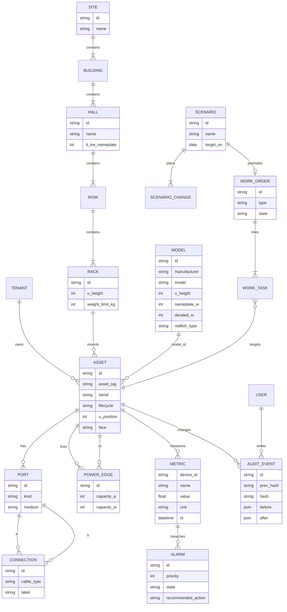

# Unubtanium 2.0 DCIM gap analysis

Inventory of `prototypes/access-control` against an Nlyte-style DCIM. No product code was changed for this pass. The working rule is `.cursor/rules/dcim.mdc`.

Reference: Nlyte covers asset lifecycle, a model library, capacity planning, connectivity, power-chain modeling, workflow and change, monitoring integration, what-if planning, reporting, and external integrations. Unubtanium's advantage to keep is out-of-band action: ACS serial, ACS KVM, RM1048, and a path to Redfish.

## 1. Current architecture

There is no application backend. The browser is the whole product.

| Layer | What it is |
| --- | --- |
| UI | Vite 6 + TypeScript + lit-html. Views are string templates in `src/views/` and `src/ui/`. One paint function in `src/ui/render.ts` replaces `#app`. |
| Floor | CSS 3D scene in `src/views/floor.ts`. Campus, hall interior, rack chassis, and the hall walkthrough all live here. |
| Domain | In-process modules: sessions, outlet policy, failover, leak, audit, single-master, route, storage, demo, analyzer. |
| Static server | `serve.py` only. It serves `dist/` on port 8766 (HTTP and HTTPS) and rewrites `/DCIAC/` to the site root. It has no routes, database, or auth. |
| Data | TypeScript constants plus one `localStorage` key, `dciac.world`. |
| Tests | Playwright against the built site (`e2e/`). No unit tests for capacity or power math. |

Boot path: `src/main.ts` calls `boot()`, which restores `localStorage`, signs nobody in, and renders the login screen. `window.AccessDemo` exposes state, devices, and load injection for tests.

The Lab is not a second data source. It is a drawer (`src/views/lab.ts`) that mutates the same in-memory devices, outlets, leak flag, RM1048 health, and maintenance window the UI already reads. Telemetry is a timer: `stepCapacity()` in `src/domain/failover.ts` nudges `device.load` from seeds in `src/data/pods.ts`. Serial Watch (`src/ui/alarms.ts`) derives P1–P3 text from those flags and writes audit rows as user `acs.watch`.

Roles are three buttons with no password (`src/data/users.ts`, `src/views/login.ts`):

- Administrator (`dsvs.admin`) can edit the ACS asset tag and virtual media.
- Operator (`dsvs.operator`) can open consoles and cycle bound outlets.
- ReadOnly (`colo.readonly`) can open consoles but not type, and cannot cycle outlets.

Checks are scattered in the view and domain modules. Nothing enforces them on a server.

Hash routing (`src/domain/route.ts`) remembers the screen, hall, rack, device, and Now/Future flag. It does not load records from an API.

## 2. Hard-coded versus persisted

Persisted in `localStorage` (`src/domain/storage.ts`), and only for objects that already exist in the seed:

- Open sessions, audit log (capped at 300), acknowledged alarms
- Outlet on/off/cycling for the 11 seeded outlets
- BMC, RDP, watch-deny, failover timers, and load for the named A14 devices
- Leak flag, maintenance window, RM1048 health, ACS asset tag

Hard-coded and rebuilt on every load:

| Data | Where | Notes |
| --- | --- | --- |
| 10 halls × 20 racks, CDUs, busways, containment | `src/data/pods.ts` `buildHall` | Hall 1 id stays `pod-a`. A14 is the only ACS domain. |
| Plant ratings | `PLANT` in `pods.ts` | 24 MW IT, 4 MW CDU per hall, 2×32 MW feeders, 6×5 MW coolers. Not derived from assets. |
| Yard gear | `YARD` | Two feeders, two transformers, four 8 MW modules, two batteries, six coolers, two pump skids, OneCore. |
| GPU trays, switch, DC shelf, 48 ACS ports | `src/data/devices.ts` | U position, tty, outlet, and a `redfishId` string. Ports 15 and 16 are refused (`users.ts`). |
| Outlet bindings | `src/data/outlets.ts` | 11 outlets. Outlet 6 is unbound. DI-1 leak locks outlets 1 and 2. |
| Device library | `src/data/library.ts` | 18 models. Placements live in `state.plan` and are not saved. |
| Dragged floor positions | mutated `x`/`y` on rack and yard objects | Lost on refresh. |
| Users | `users.ts` | Three identities. |
| Now/Future | `state.horizon` | Visual only. Future restores dark BMC paths; it does not add, move, or remove assets. |

There is no SQLite, ORM, REST API, OpenAPI spec, webhook, or time-series store.

## 3. Gap against Nlyte modules

| Module | Status | What exists | What is missing |
| --- | --- | --- | --- |
| Asset management | Partial | Halls, racks, trays, yard gear, one asset tag, lifecycle words only in copy | No asset repository, tag/serial/owner, lifecycle states, warranty, custom fields, or location parent that the UI reads from an API |
| Model library | Partial | Drag catalog with maker, U, W, A, volts, power ports, network ports, box size | No admin CRUD, clone, CSV, images, derate, plug type, redundancy class, weight, or "used by N assets" |
| Capacity: space | Partial | `freeU()` sums rough U, not a contiguous map | No U-by-U occupancy, contiguous blocks, weight, depth, or "racks that fit this model" |
| Capacity: power | Partial | Nameplate-style MW on the plant card and per-device load percents | No provisioned vs measured vs stranded kW, no per-circuit roll-up |
| Capacity: cooling | Partial | CDU and cooler nameplates, inlet °C on trays, hot/cold aisle graphics | No CDU/cooler vs heat load, no ASHRAE band check |
| Capacity: network | Missing | Port counts on library tiles | No free ports by speed |
| Connectivity and cables | Partial | ACS port map for rack A14, serial binding, two refused ports | No Port/Connection/cable entities, no trace, no label generator, no double-book check |
| Power chain | Partial | Manage view narrates grid → module → bus → shelf → tray. Outlets bind to A14 devices | No graph, no A/B path, no edge capacity, no single-node failure test |
| Workflow / change | Partial | Maintenance window, a typed work-order number before outlet cycle, audit row | No work-order record, states, approvals, task lines, or "verified updates the asset" |
| Monitoring and alarms | Partial | Serial Watch, P1–P3, Ack, Open serial, ACS KVM, Explain, leak and outlet alarms | No collector interface, Redfish/SNMP/BACnet adapters, time series, thresholds, suppression, escalation, or charts |
| What-if / future | Partial | Now/Future toggle and ghost yard pieces | No named scenario, dated changes, future capacity run, diff, or promote-to-work-order |
| Reporting | Missing | Audit table and the plant HUD | No inventory, capacity, PUE, MTTA/MTTR, CSV/PDF, or schedule |
| Integrations | Missing | `redfishId` strings and simulated Redfish serial text | No ServiceNow, vCenter, BMS, webhooks, or API tokens |
| Discovery and reconciliation | Missing | ACS domain check that gear must be in rack A14 | No discovery, mismatch queue, or physical audit |
| RBAC / tenancy | Partial | Three demo roles, UI gates on outlets, console input, and asset tag | No passwords, OIDC/SAML, API enforcement, tenant scope, or tamper-evident audit |

## 4. Proposed data model

This is the target, not the current schema. Lab telemetry writes `Metric` rows. It does not create or move assets. Names follow Redfish/OCP where a term already exists (`PowerWatt`, `TemperatureCelsius`, rack U).

Location chain for non-rack gear: Site → Yard (a Building) → Feeder, Transformer, Power module, UPS, Battery, Cooler, Pump skid. Hall-level gear (CDU, busway, containment) hangs off Hall. Rack-level gear (rPDU, tray, switch) hangs off Rack with `u_position` null for zero-U.

Power chain the graph must be able to express: Feeder A/B → Transformer → Power module or UPS → Busway or PDU → rPDU outlet → device PSU. Each edge stores amps and watts. Redundancy is a query: remove one upstream node, recompute load, flag devices with no remaining feed and nodes over 80% and 100%.

## 5. Order of work

Each step assumes the previous one is merged. Do not start a later step in the same change.

1. Persistent assets. SQLite behind a small API. Seed the 10×20 campus and the yard. UI reads the API. Lab writes telemetry only.
2. Model library. Admin edit, clone, CSV, fit checks when a tile becomes an asset.
3. Rack elevation. Front and rear, collision, budget panel, PNG/PDF. Hall click opens it.
4. Power chain and single-failure tests.
5. Ports, cables, and the existing ACS tty map as seed.
6. Capacity dashboard and Find a home.
7. Scenarios on the Now/Future toggle. Promote creates work orders.
8. Work orders, approvals, maintenance lock, ServiceNow stub.
9. Monitoring pipeline. Keep BMC-dark → ACS serial and RDP-down → ACS KVM as the recommended action.
10. Reports, including PUE.
11. Discovery and reconciliation.
12. OpenAPI, tokens, webhooks, integration stubs.
13. Real auth, tenant scope, hash-chained audit.
14. Playwright path: place a Dell PowerEdge R760 in Hall 3, promote an install, fail Feeder A, check the audit log.

## 6. Keep while building

- One click from a P1 to ACS serial or ACS KVM.
- The A14 domain rule until tenancy replaces it on purpose.
- Units already used in the UI: W, A, kW, MW, °C, U.
- The Lab as a collector adapter, not a parallel UI model.
- The static `serve.py` preview until an API exists. Add the API beside it. Do not replace the floor, walkthrough, or Serial Watch with a new framework.
